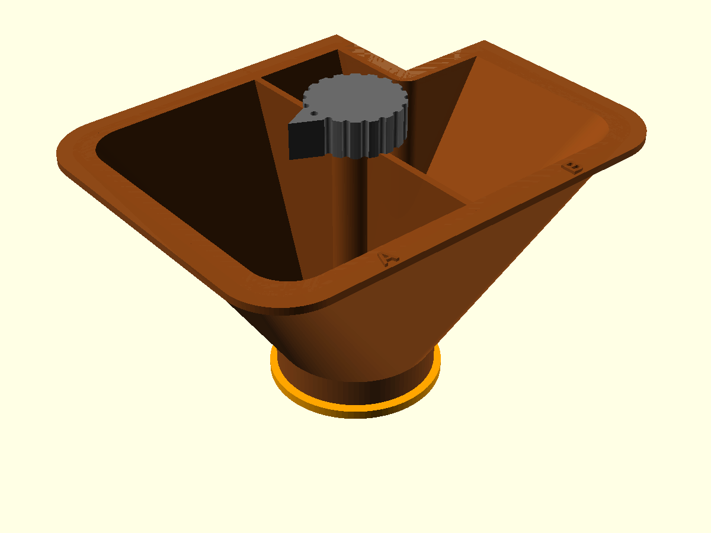

# Recipient dublu pentru boabe – DeLonghi Magnifica Start ECAM 220.21.B

Un insert printat 3D care se pune **în recipientul original de boabe** și îl împarte în două
compartimente, **A** și **B**. La ieșirea spre râșniță e un disc selector. Rotești butonul de sus
cu 180° și boabele cad dintr-un compartiment sau din celălalt. Săgeata butonului arată
compartimentul activ.

## Piese

| Fișier | Ce e | Cum se printează |
|---|---|---|
| `cutie.stl` | pâlnia cu cele două compartimente | **cu buza în jos** (fără suporturi) |
| `selector.stl` | discul cu fantă și axul, dintr-o bucată | cu discul pe pat |
| `buton.stl` | butonul cu săgeată, se pune pe ax | e deja întors, cu fața pe pat |

Material: **PETG** (sau PLA, dacă e alimentar). Strat 0,2 mm, 3 pereți, umplere 15–20%.

## ÎNAINTE de print: măsoară aparatul

Fișierele STL sunt generate cu valori estimate. Deschide `hopper_dublu.scad` în
[OpenSCAD](https://openscad.org) (gratuit), schimbă valorile de sus și exportă din nou (F6, apoi F7):

1. **`lungime` / `adancime`**: deschiderea interioară a recipientului de boabe, minus 1–2 mm.
2. **`inaltime`**: distanța dintre gâtul râșniței și marginea de sus. Capacul trebuie să se mai închidă.
3. **`iesire_d`, `iesire_x`, `iesire_y`**: diametrul gâtului râșniței și cât e decalat față de centru.
4. **`decupaj_x` / `decupaj_y`**: butonul de reglaj al măcinării e **în interiorul recipientului**.
   Decupajul lasă loc pentru el. Ajustează-i dimensiunea și poziția (implicit e în colțul din spate-dreapta).

Mai întâi printează doar o „felie” de test (de exemplu cu `inaltime = 15`) ca să verifici
dacă se potrivește.

## Montaj

1. Bagă axul selectorului pe dedesubt, prin coloana centrală a cutiei.
2. Pune butonul pe capătul plat al axului (dacă e prea lejer, prinde-l cu o picătură de adeziv).
3. Pune insertul în recipient. Discul trebuie să stea deasupra râșniței **fără să atingă** melcul.

## De știut

- După ce schimbi compartimentul, în râșniță rămân câteva grame din cafeaua anterioară.
  Prima cafea va fi un amestec, sau poți face o cafea scurtă de „golire”.
- Încape mai puțină cafea decât în recipientul original (aproximativ 2 × 80–100 g).
- **Alternativă fără print:** aparatul are deja pâlnie pentru **cafea măcinată**. Pui boabele
  obișnuite în recipient și o măsură de altă cafea (de exemplu decofeinizată) în pâlnie,
  apoi o selectezi din meniul aparatului.
- Folosești pe propria răspundere: verifică să nu cadă bucăți de plastic în râșniță.
