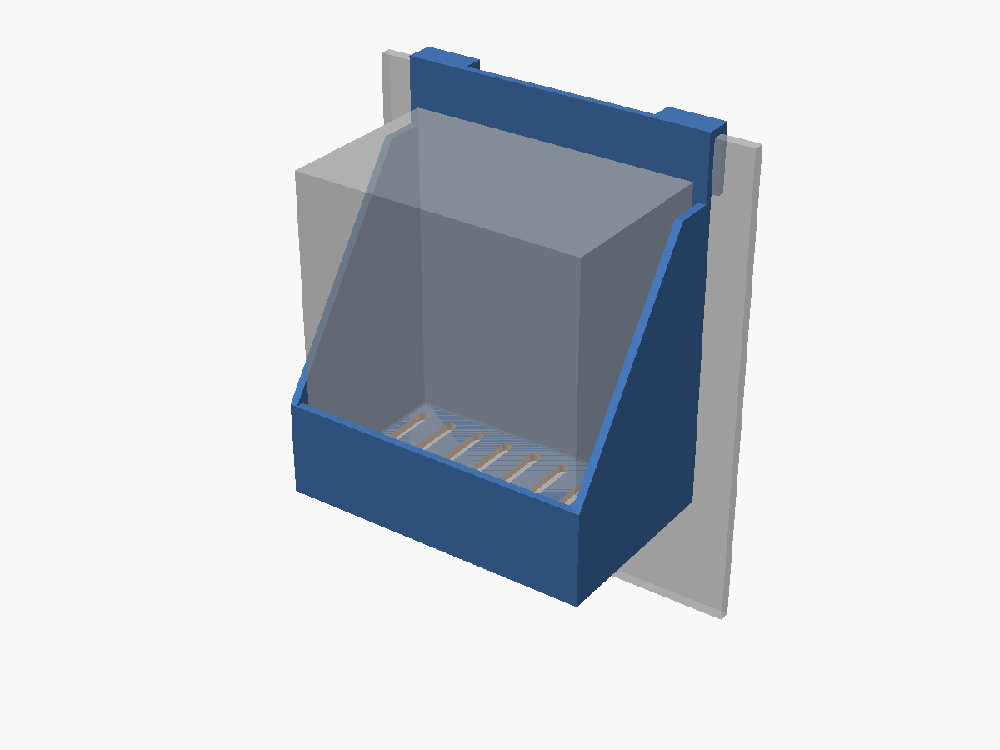

# Suport agățat pe acvariu: OASE FiltoSmart 60

Coș care se agață pe marginea geamului acvariului și ține filtrul OASE FiltoSmart 60
(150 × 90 × 164 mm, conform OASE) pe exteriorul acvariului.

- `suport_filtosmart60.stl`: gata de printat (geam de 6 mm)
- `suport_filtosmart60.scad`: model parametric (OpenSCAD). Modifică `geam_grosime` după geamul tău
  și exportă din nou (F6, apoi F7)

## Parametri importanți
| Parametru | Implicit | Ce face |
|---|---|---|
| `geam_grosime` | 6 | grosimea geamului acvariului (se adaugă automat 1 mm joc) |
| `sub_margine` | 20 | cât de jos stă capacul filtrului sub marginea geamului |
| `carlig_interior` | 30 | cât intră cârligul în interiorul acvariului |
| `joc` | 2 | jocul filtrului în coș, pe fiecare parte |

## Printare
- Culcat pe una din fețele laterale, deci nu are nevoie de suporturi
- PETG (rezistă mai bine la apă și umiditate decât PLA), 4 perimetre, 25–30% infill
- Gabarit aproximativ: 162 × 117 × 196 mm
